# La grieta del cielo 2.0 (TF Client 1.3.95)

Estado: **19 oct 2026, hecha y publicada en la TF Client 1.3.95** (rama `claude/peaceful-gauss-4nzddg`; antes, a
medias, en `claude/trusting-euler-rrxyae`, PR en borrador https://github.com/modelqdeluxe-ops/ss/pull/137). El shader
y la vista previa son los de ese trabajo; el Java, la máscara de las nubes y la prueba en el juego, de la 1.3.95
(§3 y §5). Queda que **el dueño la vea en su servidor** (y diga si le gusta o qué cambiar).

Lee también: `CLAUDE.md` (reglas del dueño), el CHECKPOINT de `HANDOFF.md`, `SIGUIENTE-IA.md` y `tf-client/JEFES.md`
§3.18 (el evento), §3.19 (1.3.94) y §3.20 (este trabajo, resumido).

---

## 1. Lo que pidió el dueño (por orden, literal)

1. **1.3.93** (el evento): *«cuando yo coloque el NPC, una grieta grande se dibujará en el cielo, con animación épica que
   asuste a todo el server, y que cuando volteen a verla un leve distorsión en su cámara, ojo, una leve distorsión. Esta
   animación debe tener previamente como un sonido de temblor o algo de que algo oscuro se avecina y un leve temblorcito,
   un mensaje en chat del NPC que diga Algo siniestro se avecina al Overworld, y luego pum la animación de la grieta en
   el cielo, como que se rompe la dimensión, y luego en chat dice el NPC dónde se encuentra (el spawn)...»* y *«el spawn
   es un Overworld aparte, usamos un plugin»*. → Hecho en la 1.3.93 (JEFES §3.18).
2. **1.3.94**: *«cuando me matan y regreso al Overworld la grieta sale ahí (junto al horizonte) y no en el cielo. Haz más
   grande esa grieta, y más épico y siniestro el aparecimiento, y un poco más de tiempo del temblor...»* → Hecho en la
   1.3.94 (dirección fija del cielo, más grande, preludio de 12 s; JEFES §3.19).
3. **Ahora (lo que está a medias)**: *«la animación, sonido de cristal, tamaño, diseño de la grieta es una mierda...
   esmérate por hacer algo chingón men por favor.»* → **Grieta 2.0**: diseño, animación, tamaño y sonidos nuevos (sin
   cristal).

Lo que el dueño rechazó (la 1.3.94 en la prueba en el juego, sin y con shaders): una lente estrecha con rayos alrededor,
pequeña, y sonidos de cristal roto:

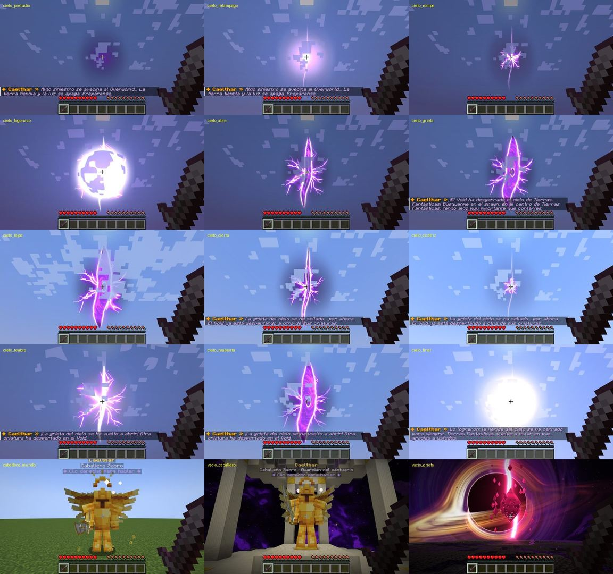
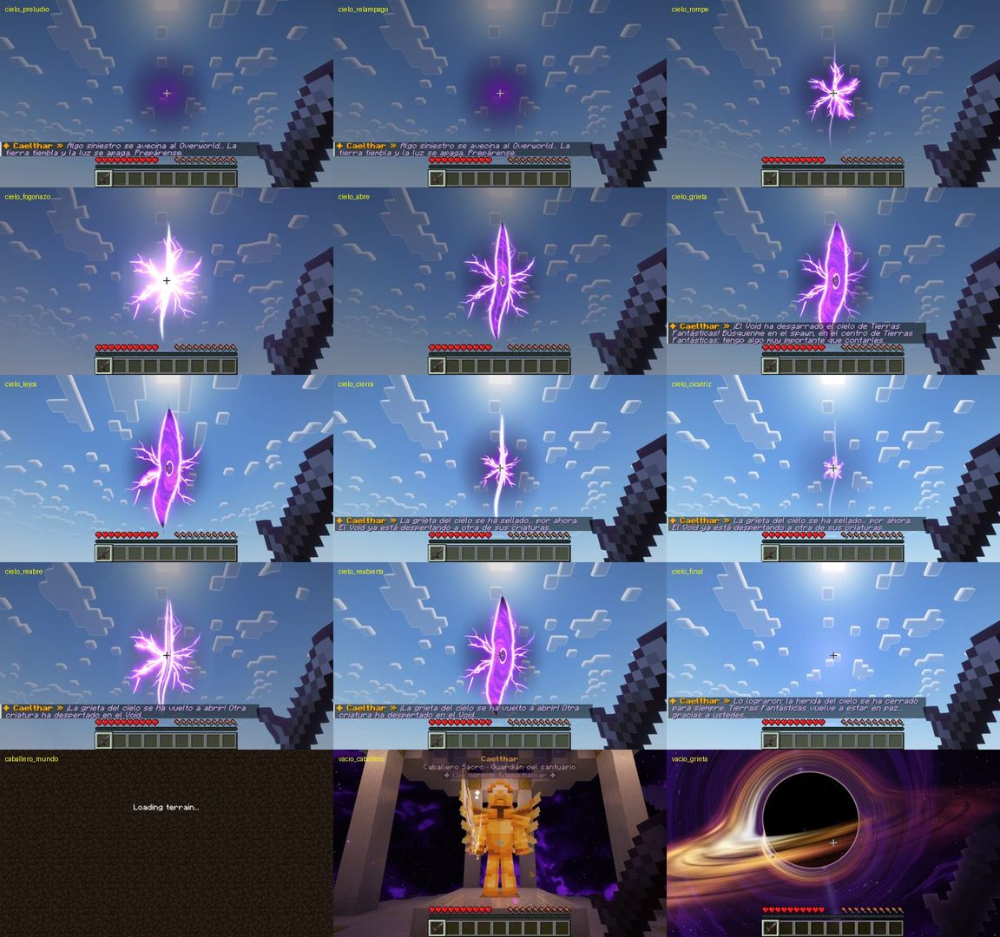

---

## 2. El diseño nuevo (hecho: `src/main/resources/assets/tfclient/shaders/core/sky_rift.fsh`)

Toda la animación (vista previa sin el juego, con la cámara del juego mirándola de frente; la última, desde el
horizonte mirando al norte):

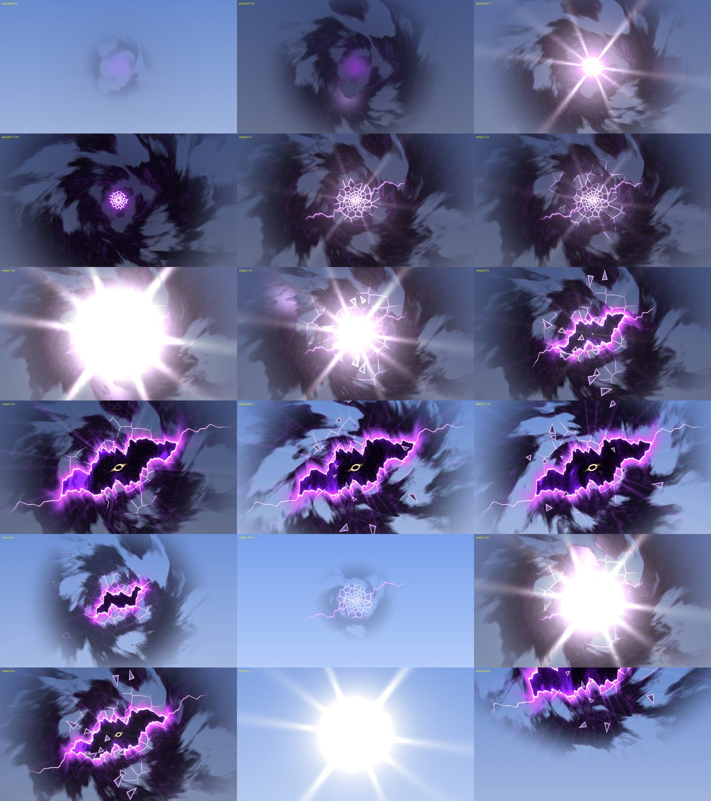

La aparición en movimiento (preludio 12 s → se rompe → abierta): [11_aparicion.gif](11_aparicion.gif)

| Momento | Imagen | Qué se ve |
|---|---|---|
| Preludio, 7,5 s | 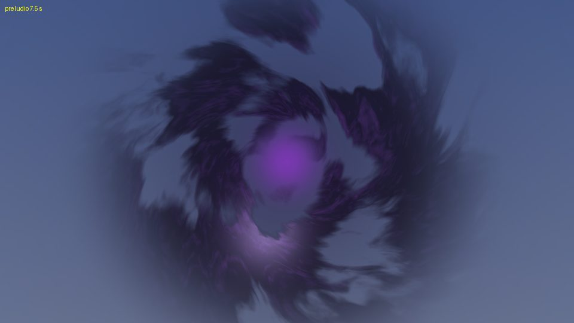 | El cielo se apaga; el vórtice de tormenta (nubes negras y violetas en espiral) crece; una sombra y un resplandor violeta laten en el centro. |
| Preludio, 11,6 s | 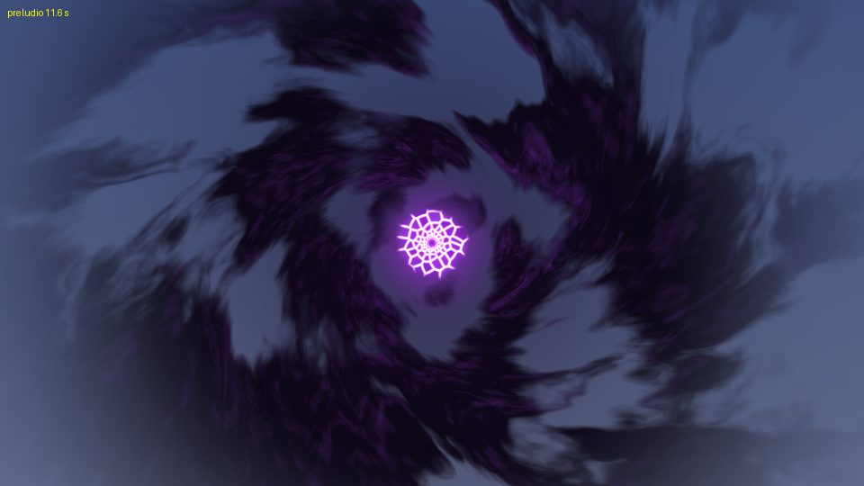 | La tormenta formada; las primeras grietas en telaraña en el centro. En los relámpagos (3,6 / 6,4 / 8,7 / 10,3 / 11,4 s) fogonazo en estrella. |
| Se rompe, 1,3 s | 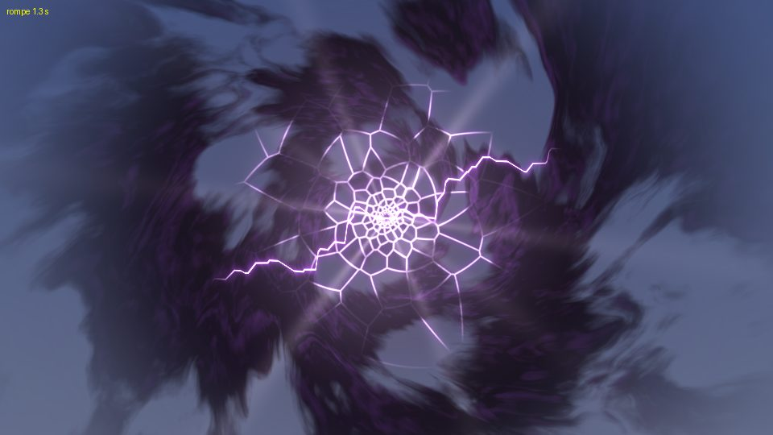 | La telaraña de fracturas se extiende a saltos; la línea quebrada por donde se va a rasgar ya se ve. |
| Estalla, 1,9 s | 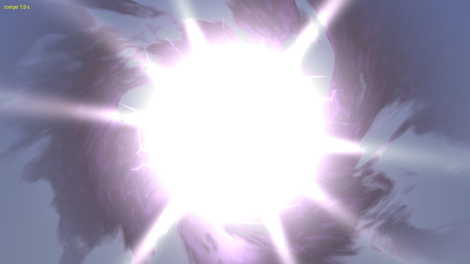 | Gran fogonazo en estrella (y onda de choque de RiftWarp). |
| Se abre, 3,5 s | 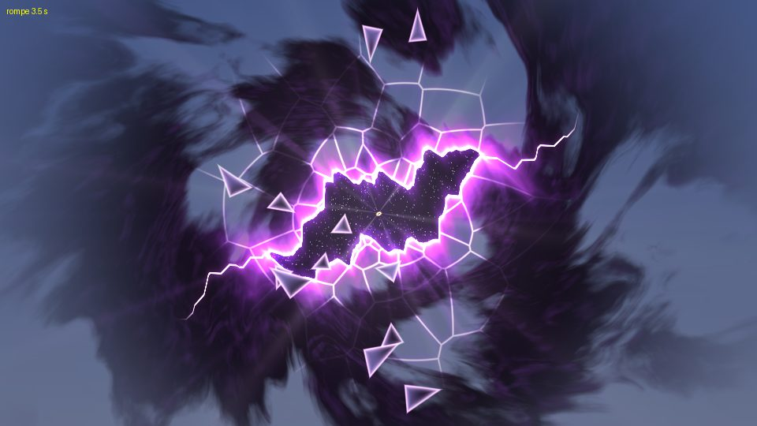 | El desgarro se abre del centro a las puntas; trozos de cristal salen disparados. |
| Abierta | 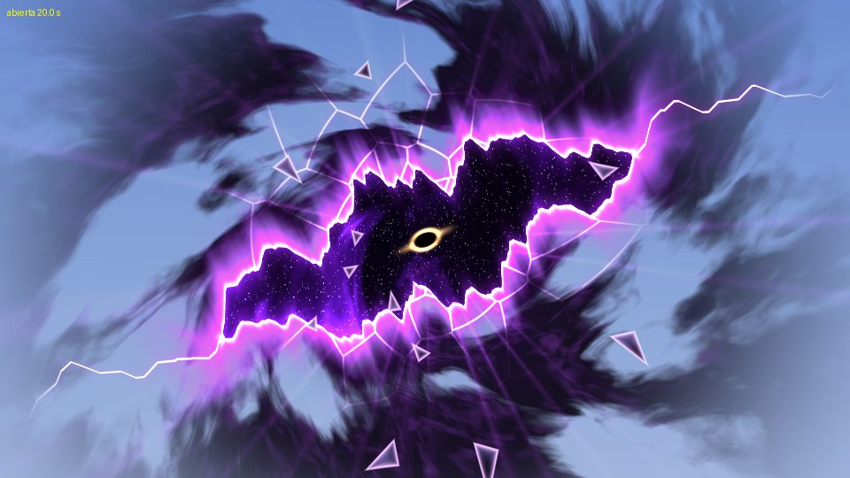 | El desgarro (~66° de largo) quebrado como un rayo, dientes angulosos, el borde ardiendo (blanco → magenta → violeta), las grietas siguen más allá de las puntas, dentro el Void con el ojo (agujero negro con anillo de oro), la tormenta alrededor, trozos de cristal que flotan hacia él, rayos de luz y de energía. |
| Se sella | 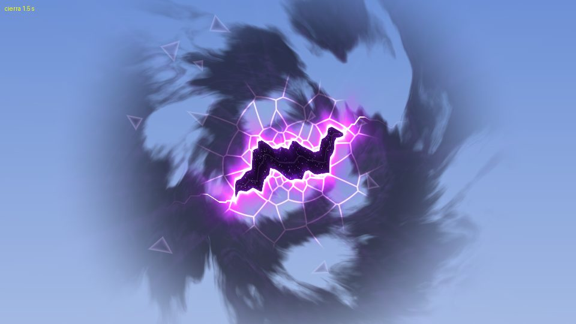 | El desgarro se cierra (cuando cae un jefe del Void). |
| Cicatriz | 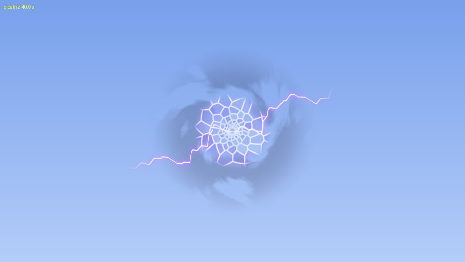 | Sellada: la telaraña apagada, la línea quebrada y una tormenta débil. |
| Se vuelve a abrir | 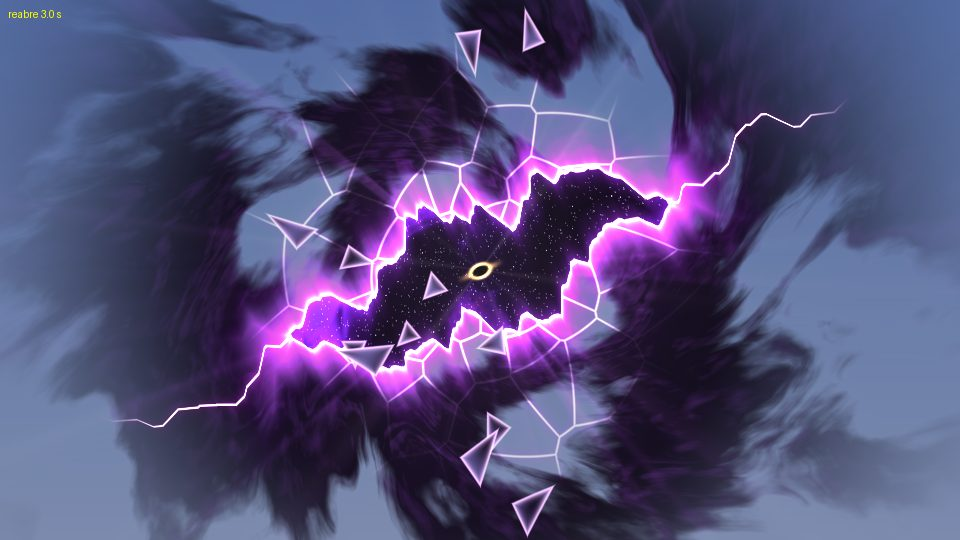 | Vuelve la tormenta, estalla otra vez y se abre (sonido del Wither al nacer). |
| El final | 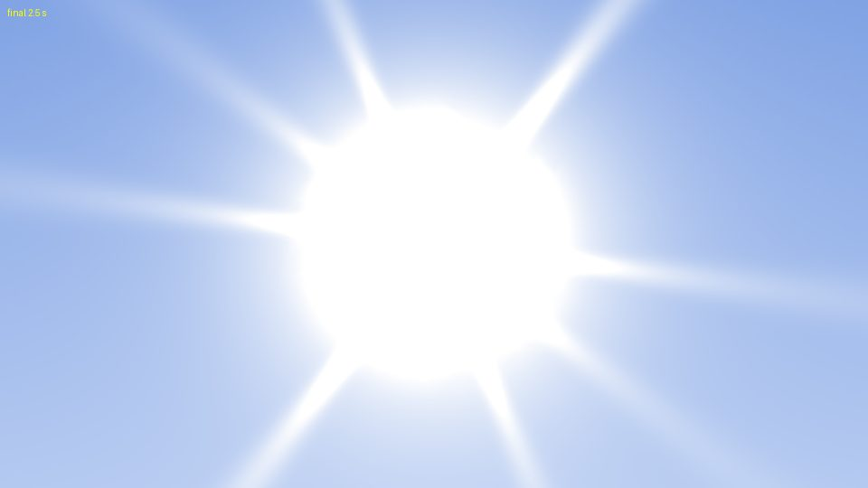 | Gran fogonazo y desaparece todo (`/tf void cielo final`). |

### Cómo está hecho el shader

- **Coordenadas**: todo en ángulos de cielo (radianes) alrededor del centro de la grieta, con proyección azimutal
  equidistante: `RiftF` = el centro, `RiftR` = derecha, `RiftU` = arriba (direcciones relativas a la cámara; el cuadro
  está centrado en la cámara, así que `vDir` = la dirección de cada píxel). Así mide lo mismo la mires como la mires y
  no se estira en los bordes del cuadro. Fuera de 1,25 rad, `discard`.
- **Uniformes** (`sky_rift.json`): `STime`, `Crack` (0..1, telaraña), `Open` (0..1, desgarro), `Flash` (0..~1,6), `Alpha`,
  `AtFar` (1 = después del paquete de shaders), `Dark` (0..1, preludio), `Storm` (0..1, tormenta), `Shatter` (segundos
  desde que estalla, < 0 si no), `RiftF`, `RiftR`, `RiftU` (vec3), `Sampler0` (= `VoidSky.PANORAMA`, las nebulosas).
- **Telaraña** (`voronoi`, `cellPoint`, `NS` = 15): Voronoi en coordenadas logarítmico-polares (ángulo × 15/2π,
  log(r) × 15/2π; periódico en el ángulo con `wrapX`): trozos pequeños junto al centro y grandes lejos, grietas radiales
  y en anillo. Llega a `0,6 × Crack` rad. Ancho de línea en radianes = distancia en la telaraña × `toRad` (= r·2π/15).
  *Probado y descartado*: celdas iguales (parecía un panal o adoquines).
- **Desgarro** (`tearShape`, `tearAxis`, `tearLen`, `jag`): eje en zigzag (ondas triangulares), ancho en huso
  (`HALF_W` 0,2), dientes angulosos con ruido a tramos rectos (distintos arriba y abajo), `HALF_LEN` 0,58, `TILT` 0,42;
  se abre del centro a las puntas. Borde ardiendo por fuera (`hot`, `mag`, `vio`, `flame`), neblina violeta por dentro
  junto al filo, grietas que siguen 0,34 rad más allá de las puntas, rayos de luz (`rays`) y de energía (`bolt`).
  *Probado y descartado*: hacer el agujero con los trozos de la telaraña que faltan (mancha con forma de murciélago y
  trozos sueltos lejos) y dientes con ruido suave (parecía pelo).
- **Dentro**: nebulosas en remolino + las de la dirección en que miras (paralaje), estrellas (dos capas) y el ojo del
  Void (agujero negro de 0,032 rad con anillo de oro que gira y un disco fino).
- **Tormenta** (`Storm`, `STORM_R` 1 rad): fbm con el dominio deformado en espiral (`1,15/(r+0,25)`), brazos
  (`sin(3·ang + 7·log r)`), iluminada por la grieta (borde de cada nube más claro), relámpagos dentro, y se aparta del
  desgarro (`tearShape`).
- **Trozos de cristal**: 12 triángulos; al estallar (`Shatter` 0..4 s) salen del centro; abierta, flotan en espiral
  hacia dentro. Cristal oscuro con reflejo y filo claro.
- **Preludio**: `Dark` → sombra y resplandor que late. **Línea de rasgado / cicatriz**: con `Crack` > ~0,3 y cerrada.
- **Fogonazo** en estrella.
- Salida: color «sin premultiplicar» (`col / alpha`, alpha) con mezcla `SRC_ALPHA, ONE_MINUS_SRC_ALPHA`.

### La vista previa

```
xvfb-run -a python3 -I tools/void/grieta_cielo_preview.py carpeta [--gif] [--size 960x540]
```

Dibuja como el juego (el cuadro a `DRAW` bloques en la dirección `SkyRift.YAW/PITCH`, cámara de 70°) sobre un cielo de
día que se apaga como en el juego. **Su función `look(phase, t)` es la línea de tiempo buena**: hay que copiarla tal
cual a `SkyRiftClient.look()` (fases `preludio`, `rompe`, `abierta`, `cierra`, `cicatriz`, `reabre`, `final`).

---

## 3. Lo que falta (Java), paso a paso

Todo en `src/main/java/net/tierrasfantasticas/tfclient/vacio/SkyRiftClient.java` (hoy es el de la 1.3.94).

### 3.1 El cuadro y los uniformes

```java
private static final double DRAW = 30;     // las esquinas a ~90 bloques (dentro del plano lejano con 2 chunks: 128)
private static final double ANG = 1.1;     // medio ancho del cuadro, radianes (cuadrado: hh = hw, ya no ×1,4)
```

En `quad()`: `hh = hw` (cuadrado). En `render()`, además de los de ahora:

```java
Vec3[] ax = axes();   // DIR, right, up normalizados (los de quad() sin escalar)
sh.safeGetUniform("Storm").set(lk[5]);
sh.safeGetUniform("Shatter").set(lk[6]);
sh.safeGetUniform("RiftF").set((float) ax[0].x, (float) ax[0].y, (float) ax[0].z);
sh.safeGetUniform("RiftR").set((float) ax[1].x, (float) ax[1].y, (float) ax[1].z);
sh.safeGetUniform("RiftU").set((float) ax[2].x, (float) ax[2].y, (float) ax[2].z);
```

(`Uniform.set(float, float, float)` existe en 1.20.1.) El velo que apaga el cielo y `onFogColor` se quedan como están.

### 3.2 `look()`: la línea de tiempo (copiar la de la vista previa)

Devuelve 8 valores: `{crack, open, flash, alpha, dark, storm, shatter, onda de choque}` (la onda, en radios de la
grieta para RiftWarp, o −1). Con `t` = segundos desde que llegó la animación (`since()`):

- **`FX_PRELUDE`** (t < 14): `fl` = máx. de `bump(t, f, 0.18)` en los relámpagos `{3.6, 6.4, 8.7, 10.3, 11.4}`;
  `crack` = máx(`bump(t, f_i, 0.25)·(0.12 + 0.04·i)`, `0.18·smooth(7, 12, t)`); `open` 0; `flash` = 0,45·fl;
  `alpha` 1; `dark` = 0,95·smooth(0,5, 10, t); `storm` = smooth(0, 11,5, t); `shatter` −1; onda −1.
- **`FX_BURST`** (t < 10): `crack` = 0,18 + saltos (cada uno suave en 0,14 s) a 0,3 / 0,45 / 0,62 / 0,8 / 1,0 en
  t = 0 / 0,35 / 0,75 / 1,15 / 1,5; `BREAK` = 1,8; `flash` = máx(0,35·bump(t, salto+0,05, 0,2), t ≥ BREAK ?
  1,6·e^(−(t−BREAK)·1,6) : 0,3·smooth(1,5, BREAK, t)); `open` = smooth(BREAK, 5,5, t); `alpha` 1;
  `dark` = 0,95·(1 − smooth(BREAK, 4, t)); `storm` 1; `shatter` = t ≥ BREAK ? t − BREAK : −1; onda = BREAK ≤ t <
  BREAK+2,2 ? (t−BREAK)·5 : −1.
- **Abierta** (estado `OPEN`, sin animación): `{1, 1, 0, 1, 0, 1, −1, −1}`.
- **`FX_CLOSE`** (t < 4): `crack` = 1 − 0,65·smooth(0,5, 2,5); `open` = 1 − smooth(0, 2,2); `flash` = 0,8·e^(−|t−2,3|·6);
  `alpha` = 1 − 0,2·smooth(2,3, 3,5); `dark` 0; `storm` = 1 − 0,75·smooth(0,5, 3); `shatter` −1; onda −1.
- **Sellada** (estado `CLOSED`): `{0.35, 0, 0, 0.8, 0, 0.25, −1, −1}`.
- **`FX_REOPEN`** (t < 7): `BREAK` = 1,2; `crack` = 0,35 + 0,65·smooth(0, 1,2); `open` = smooth(1,2, 4); `flash` = t ≥ 1,2 ?
  1,3·e^(−(t−1,2)·1,8) : 0,3·smooth(0,9, 1,2); `alpha` = 0,8 + 0,2·smooth(0, 0,6); `dark` = 0,6·(1 − smooth(1,2, 3));
  `storm` = 0,25 + 0,75·smooth(0, 1,5); `shatter` = t ≥ 1,2 ? t − 1,2 : −1; onda = 1,2 ≤ t < 3,2 ? (t−1,2)·5 : −1.
- **`FX_END`** (t < 5, luego null): `crack` = 1 − smooth(0,5, 3); `open` = 1 − smooth(0, 2,5); `flash` = 1,6·e^(−|t−2,5|·3,5);
  `alpha` = 1 − smooth(2,6, 4,5); `dark` 0; `storm` = 1 − smooth(0,5, 3,5); `shatter` −1; onda −1.

`skyDim()` (el velo) igual que ahora, pero en `FX_BURST` cuenta desde `BREAK` = 1,8 y `OPENED` = 5,5. `shake()`: igual
de forma, con `BREAK` 1,8 (golpe 2,0 al estallar). Quitar `STEP_V/STEP_T` viejos (0,15…) y poner los nuevos.

### 3.3 Sonidos (SIN CRISTAL: el dueño se quejó del «sonido de cristal»)

Quitar todos los `GLASS_BREAK`. Propuesta (todos `SimpleSoundInstance.forUI`, ya en `play()`):

- Preludio: como ahora (warden emerge, 18 latidos, lamento, truenos en los relámpagos, sculk, Wither, dragón, rugido del
  warden).
- Se rompe: t = 0 `WARDEN_SONIC_CHARGE` (0,5); en cada salto de las grietas `LIGHTNING_BOLT_IMPACT` (0,5–0,7, 0,6); al
  estallar (1,8 s) `TRIDENT_THUNDER` (0,6, 1) + `GENERIC_EXPLODE` (0,45, 1) + `WARDEN_SONIC_BOOM` (0,5, 0,8) +
  `END_PORTAL_SPAWN` (0,5, 1); a los 2,2 s `ENDER_DRAGON_DEATH` (0,55, 0,6: rugido largo y grave mientras se abre);
  a los 3 s `PORTAL_TRIGGER` (0,4, 0,6).
- Se vuelve a abrir: t = 0 `WITHER_SPAWN` (0,8, 0,55); 1,2 s `TRIDENT_THUNDER` (0,7) + `END_PORTAL_SPAWN` (0,6).
- Se sella: `BEACON_DEACTIVATE` (0,5); 2,3 s `CONDUIT_DEACTIVATE` (0,6) + `LIGHTNING_BOLT_THUNDER` (1, 0,5).
- Final: `BEACON_DEACTIVATE`; 2,5 s `TRIDENT_THUNDER` (1) + `UI_TOAST_CHALLENGE_COMPLETE`.
- Abierta (opcional, «que asuste»): un trueno lejano `LIGHTNING_BOLT_THUNDER` (0,4, 0,25) cada 30–50 s.

Ojo: en 1.20.1 algunos `SoundEvents` son `Holder.Reference` (los `AMBIENT_*`, `NOTE_BLOCK_*`, `MUSIC_*`): no los pases
a `forUI` sin `.value()`. Los de la lista de arriba son `SoundEvent`.

### 3.4 `warp()` (la distorsión leve de RiftWarp al mirarla)

El `right` del cuadro ahora es enorme: el punto para medir el radio debe ser
`DIR.scale(DRAW).add(right.normalize().scale(Math.tan(0.3) * DRAW))` (no `q[0].add(q[1].scale(0.6))`). Devuelve también
la onda de choque (índice 5 de `warp`, como ahora: `lk[7]`).

### 3.5 La prueba en el juego

- `bosses/BossTestClient.java`: `SKY` / `SKY_AT` para las capturas a los tiempos nuevos:
  preludio `{"preludio" 7.5, "relampago" 8.66}`, rompe `{"rompe" 1.0, "fogonazo" 1.85, "abre" 3.5, "grieta" 7.0}`,
  sella `{1.4, 5}`, reabre `{1.5, 4.5}`, final `{2.5, 6}`.
- `bosses/BossTest.java`: el evento ya está en la prueba de `vacio` (t = 2470 empieza; 2945–3385 el diálogo; 3390 vista
  desde 2000 bloques; 3520 se sella; 4210 se vuelve a abrir sola; 4300 el final). No hace falta tocarlo.
- Versión **1.3.95** (`tf-client/gradle.properties` `mod_version` y `TFClient.VERSION`), `python3 tools/bosses/verificar.py`
  («todo bien»), commit con `[prueba-jefes=vacio]` y otro con `[prueba-jefes=vacio] [shaders]`, esperar con
  `tools/bosses/esperar_prueba.sh <hash> <scratch>` en segundo plano y mirar las capturas `00_vacio_cielo_*`:
  - que el desgarro no salga blanco por dentro (el borde solo arde por fuera: `(1 − holeK)`),
  - que no haya rectángulos ni el borde del cuadro (todo se apaga antes de 1,2 rad),
  - que la tormenta no tape el desgarro y que con shaders se vea solo donde se ve el cielo,
  - el informe: «grieta del cielo, rota: abierta… cielo apagado como mucho 0.60», «al caer un jefe del Void: sellada»,
    «otra vez lista: abierta», «el final: cerrada para siempre».
- Documentar en JEFES §3.20 (pasarlo de «en curso» a hecho), HANDOFF CHECKPOINT y SIGUIENTE-IA; publicar (PR → squash →
  comprobar la Release `tfclient-v1.3.95` → reiniciar la rama desde `main`).

---

## 4. Trampas que ya se encontraron (no las repitas)

- **Sin paquete de shaders** la grieta se dibuja en `RenderLevelStageEvent.Stage.AFTER_SKY` (detrás de todo); **con
  Oculus** en `AfterShaders.end` (después de su pasada final, `AtFar` = 1, profundidad 0,9999995 con `LEQUAL`: solo donde
  se ve el cielo). Oculus bloquea lo que no es suyo mientras dibuja el mundo.
- **El cuadro tiene que quedar dentro del plano lejano** (con 2 chunks de distancia de renderizado, 128 bloques): por eso
  `DRAW` pequeño.
- **Vec3.directionFromRotation(PITCH, YAW)**: la grieta está al norte a 50° (`SkyRift.YAW` 180, `PITCH` −50).
- **El agujero negro del Void** (`void_sky.fsh`): el parámetro de impacto solo vale para los rayos que van hacia él
  (1.3.93: salía un agujero falso en el lado opuesto del cielo).
- **La prueba en el juego**: al volver del Void, Caelthar es otra entidad (su chunk se descargó) y una pulsación de
  diálogo que no se usó queda pendiente: `BossTest` ya lo resuelve.
- **El rescate al caer al vacío**: un teletransporte cada 2 s como mucho (con un cliente lento no se completaba).
- **La espada de Caelthar**: como un jugador (`ItemInHandLayer`); `PoseStack.mulPoseMatrix` no gira las normales.
- **Vista previa vs. juego**: la vista previa no dibuja la niebla ni las nubes de Minecraft; en el juego las nubes
  vanilla quedan delante de la grieta (se dibujan después).
